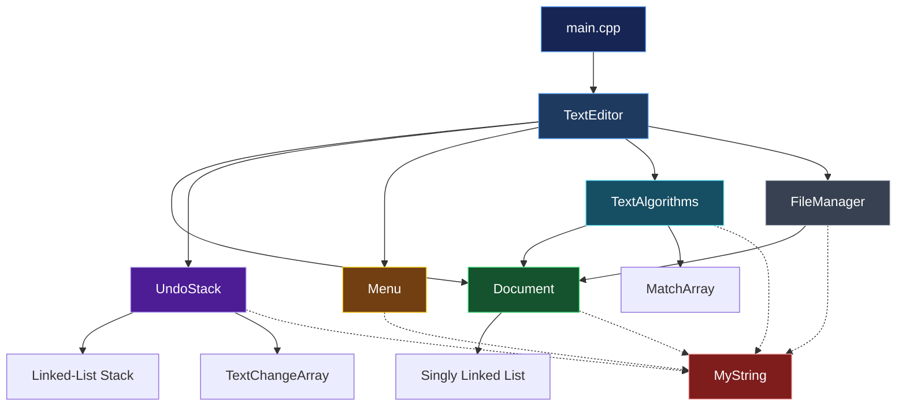

<div align="center">

# ⌘ TEXT EDITOR

### A Text Editor Built from the Ground Up.

**Understanding the mechanics of text editing through Data Structures and Algorithms.**

</div>

## ◈ 01 — The Project

What happens when you insert a character, search for a word, replace text, or undo an edit?

A text editor may appear simple on the surface, but behind every operation lies a combination of data structures, algorithms, memory management, and file handling.

**Text Editor** is a console-based application written in C++ that explores these mechanisms through manually implemented components. Instead of relying on ready-made containers and `std::string`, the project builds its foundation from:

* a custom **singly linked list** for document storage,
* a custom **linked-list stack** for undo history,
* custom **resizable dynamic arrays** for search results and replacement records,
* a custom **`MyString`** class built on a raw, null-terminated character array.

The objective is to understand not only how a text editor works, but how its components interact to produce a reliable application, including how it fails safely when something goes wrong.

---

## ✦ 02 — Features

|     | Feature                 | Description                                                                          |
| :-: | :---------------------- | :----------------------------------------------------------------------------------- |
|  📄 | **Document Management** | New, open, save, save as, close, and delete files.                                   |
|  ✏️ | **Text Editing**        | Insert and delete text at any character position; insert and delete whole lines.     |
|  🧩 | **Write-Anywhere Edits**| Inserting past the end creates missing lines and pads with spaces (with safety caps).|
|  🔎 | **Pattern Searching**   | Lists every match with its line number and character position.                       |
|  🔄 | **Text Replacement**    | Replace the first occurrence or all non-overlapping occurrences.                     |
|  ↩️ | **Undo System**         | Multi-step undo for every edit, including Replace All as a single step.              |
|  📊 | **Document Statistics** | Line, word, and character counts.                                                    |
|  🛡️ | **Safe File Handling**  | Atomic saves, binary-file rejection, and filename validation.                        |
|  ⚙️ | **Error Handling**      | Strict input parsing, bounds checks, and rollback on failed operations.              |

---

### System Architecture



*Dotted lines show that every module represents text with `MyString`.*

### Module Breakdown

| Module           | Responsibility                                                                                     |
| :--------------- | :------------------------------------------------------------------------------------------------- |
| `MyString`       | Manual string class: dynamic buffer, append, insert, erase, substring, comparison, stream I/O.     |
| `Document`       | Owns the linked list of lines; line and character editing; statistics; safe iteration.             |
| `UndoStack`      | Linked-list stack of `UndoRecord`s, plus the `TextChangeArray` used to reverse Replace All.        |
| `TextAlgorithms` | Naive pattern matching, Find All, Replace First, Replace All, and the `MatchArray` result store.   |
| `FileManager`    | Opening, saving, deleting, filename normalization and validation.                                  |
| `Menu`           | Hierarchical console interface, strict input helpers, and all output formatting.                   |
| `TextEditor`     | Central controller: connects menus, document, algorithms, file operations, and undo.               |
| `main.cpp`       | Creates the editor and catches any fatal exception.                                                |

### Application Flow

1. `main.cpp` creates a `TextEditor` and calls `run()`.
2. `Menu` shows the main menu and reads a choice.
3. `TextEditor` routes it to a sub-menu (File, Edit, Find & Replace, View) and calls the relevant module.
4. Every successful edit pushes an `UndoRecord` onto `UndoStack`.
5. The result is displayed and control returns to the menu until the user exits.

---

## 🧠 04 — Data Structures: Under the Hood

### 01 / Singly Linked List

**Purpose: Document Storage**

Each node holds one line (a `MyString`) and a pointer to the next node. The list keeps both a `head` and a `tail` pointer, so appending a line is O(1).

```text
 HEAD                                                          TAIL
  |                                                              |
  v                                                              v
+----------------+     +----------------+     +----------------+
|    Line 01     |     |    Line 02     |     |    Line 03     |
|  "Hello World" | --> |  "Text Editor" | --> |  "C++ Project" | --> NULL
+----------------+     +----------------+     +----------------+
```

**Why a linked list?**

* No fixed document size.
* Inserting or deleting a line never shifts the lines after it.
* A direct application of pointer manipulation and manual memory management.

**Worth knowing:**

* `LineIterator` walks the list one node per step. Looping with `getLine(i)` would cost O(L²), so display and counting use the iterator instead.
* `swap()` exchanges two documents without copying nodes, which is what makes "load into a temporary document, then commit" cheap.
* Copying is deleted to prevent two documents from owning the same nodes.

### 02 / Linked-List Stack

**Purpose: Undo History**

Each successful edit creates an `UndoRecord` (operation type, line, position, old text, new text, and any extra data) that is pushed onto the stack.

```text
             TOP
              |
              v
        +-------------+
        |   Undo #3   |  ← Most recent operation
        +-------------+
              |
              v
        +-------------+
        |   Undo #2   |
        +-------------+
              |
              v
        +-------------+
        |   Undo #1   |  ← Oldest operation
        +-------------+
              |
             NULL
```

Operations tracked: `INSERT_TEXT`, `DELETE_TEXT`, `REPLACE_TEXT`, `REPLACE_ALL`, `INSERT_LINE`, `DELETE_LINE`.

**Why a stack?**

* LIFO matches undo exactly: the newest change is reversed first.
* O(1) push and pop, with no `std::stack`.
* `peek` + `discardTop` lets the editor remove a record only *after* the undo succeeds, so a failed undo keeps its record.

### 03 / Dynamic Arrays

**Purpose: Search Results & Replacement History**

| Array             | Stores                                           | Purpose                                      |
| :---------------- | :----------------------------------------------- | :------------------------------------------- |
| `MatchArray`      | Line number and character position of each match | Holds Find All results.                      |
| `TextChangeArray` | Line, position, old text, and new text           | Holds every change needed to reverse a Replace All. |

Both start small and **double** their capacity when full, giving amortized O(1) insertion and O(1) indexed access.

### 04 / MyString

**Purpose: Manual String Management**

A dynamically allocated, null-terminated `char` array with three members: the buffer, the current length, and the allocated capacity. Capacity doubles on demand, which keeps repeated appends cheap. Even `strlen`, `strcpy`, and `strcmp` are rewritten by hand, with no `<cstring>`.

---

## 🔍 05 — Algorithms

| Algorithm              | Description                                                                 |
| :--------------------- | :-------------------------------------------------------------------------- |
| Naive Pattern Matching | Compares the pattern against each position of a line, character by character. |
| Find All               | Applies matching to every line and records each hit in `MatchArray`.        |
| Replace First          | Replaces the first occurrence only.                                         |
| Replace All            | Replaces all non-overlapping occurrences, recording each change.            |
| Undo                   | Pops the latest record and applies the reverse operation.                   |
| Safe Save              | Writes to `<file>.tmp`, then replaces the target.                           |

### Search Behaviour

* Case-sensitive matching, one line at a time.
* Line numbers start at **1**; character positions start at **0**.
* **Find All reports overlapping matches** (searching `aa` in `aaa` gives positions 0 and 1).
* Empty patterns are rejected.

### Replace Behaviour

* **Replace All uses non-overlapping matches**, and replacement text is never rescanned, so replacing `a` with `aa` cannot loop forever.
* The new line is built in one pass, and the result length is checked against the `int` limit before building.
* All replacements from one command form **a single undo step**, restored in reverse order.
* If anything fails midway, the document is rolled back to its original state.

### Safety Behaviour

* **Padding limits:** inserting beyond the end of a document or line is allowed, but capped at 100,000 created lines and 10,000 padding spaces, so a typo like line `999999999` cannot exhaust memory.
* **Atomic open:** a file is loaded into a temporary `Document` and swapped in only after a fully successful read.
* **Binary files** (containing NUL bytes) are rejected on open.
* **Windows line endings** (`\r\n`) are handled on read; files are saved with `\n`, so a file round-trips exactly.
* **Filenames** are validated (no empty names, control characters, or `< > " | ? *`), and quotes from Windows "Copy as path" are stripped.
* **Unsaved changes:** closing, opening, or exiting asks for confirmation first.
* **End of input** (Ctrl+D / Ctrl+Z) is handled gracefully instead of looping.

---

## 🖥️ 06 — Using the Editor

The interface is a hierarchical menu. `0` always goes back.

```text
=================== TEXT EDITOR ====================
 File : a.txt  [modified]
 Lines: 3    Words: 17
--------------------------------------------------------
  1. File             new, open, save, delete, close
  2. Edit             text, lines, undo, save
  3. Find & Replace   search and replace text
  4. View             show document and statistics
  5. Help
  0. Exit
--------------------------------------------------------
```

| Menu               | Options                                                                    |
| :----------------- | :------------------------------------------------------------------------- |
| **File**           | New · Open · Save · Save As · Delete a File · Close                        |
| **Edit**           | Insert Text · Delete Text · Insert Line · Delete Line · Undo · Save        |
| **Find & Replace** | Find Text · Replace First · Replace All                                    |
| **View**           | Show Document & Statistics                                                 |
| **Help**           | Navigation, numbering conventions, and behaviour notes                     |

**Good to know**

* Character positions count **bytes**, so avoid the middle of multi-byte (non-English) characters.
* The undo history is cleared when you open, create, or close a document.

---

## 📁 07 — Project Structure

```text
Text-Editor-DSA/
│
├── include/
│   ├── MyString.h
│   ├── Document.h
│   ├── UndoStack.h
│   ├── TextAlgorithms.h
│   ├── FileManager.h
│   ├── Menu.h
│   └── TextEditor.h
│
├── src/
│   ├── main.cpp
│   ├── MyString.cpp
│   ├── Document.cpp
│   ├── UndoStack.cpp
│   ├── TextAlgorithms.cpp
│   ├── FileManager.cpp
│   ├── Menu.cpp
│   └── TextEditor.cpp
│
├── CMakeLists.txt
├── README.md
└── LICENSE
```

* `include/` holds class declarations and public interfaces.
* `src/` holds the implementations and the entry point.

---

## 🛠️ 08 — Development Environment Setup

The project uses **C++17**. Any C++17 compiler works. The recommended Windows setup is:

* Visual Studio Code
* MSYS2 UCRT64
* GCC, CMake, Ninja

### Step 1 — Install VS Code and MSYS2

Download and install **Visual Studio Code** and **MSYS2**.

### Step 2 — Install the Required Tools

Open the **MSYS2 UCRT64** terminal and update:

```bash
pacman -Syu
```

If the terminal closes during the update, reopen UCRT64 and run it again if requested. Then install the toolchain:

```bash
pacman -S --needed mingw-w64-ucrt-x86_64-gcc mingw-w64-ucrt-x86_64-cmake mingw-w64-ucrt-x86_64-ninja
```

### Step 3 — Install VS Code Extensions

Install **C/C++** and **CMake Tools**.

### Step 4 — Configure the VS Code Terminal

1. Press `Ctrl + Shift + P`.
2. Select `Terminal: Select Default Profile`.
3. Choose `bash (MSYS2)` if available, and make sure the terminal uses `MSYSTEM=UCRT64`.

### Step 5 — Verify Installation

```bash
g++ --version
cmake --version
ninja --version
```

If all three print version information, the environment is ready.

---

## 🚀 09 — Build & Run

### 01 / Clone the Repository

```bash
git clone <repository-url>
cd Text-Editor-DSA
```

### 02 / Build with CMake

```bash
cmake -S . -B build -G Ninja
cmake --build build
```

### 03 / Or Build Directly with g++

```bash
g++ -std=c++17 -Wall -Wextra -Iinclude src/*.cpp -o TextEditor
```

### 04 / Run

```bash
./build/TextEditor.exe     # CMake build on Windows (MSYS2 UCRT64)
./build/TextEditor         # CMake build on Linux / macOS
./TextEditor               # direct g++ build
```

The executable location can differ depending on the generator and configuration.

> **Note:** The generated `build/` directory should not be committed.

---

## ⏱️ 10 — Complexity Analysis

**Notation**

| Symbol | Meaning                                  | Symbol | Meaning                              |
| :----: | :--------------------------------------- | :----: | :----------------------------------- |
|   `L`  | Number of document lines                 |   `R`  | Number of search matches             |
|   `N`  | Total number of characters               |   `K`  | Number of replacement records        |
|   `C`  | Length of the affected line or string    |   `H`  | Number of undo records               |
|   `M`  | Length of the search pattern             |   `T`  | Length of inserted/replacement text  |
|   `S`  | Total size of affected original lines    |   `U`  | Total size of rebuilt lines          |
|   `P`  | Size of an undo record's stored text     |        |                                      |

### Time Complexity

| Operation                         | Time                                |
| :-------------------------------- | :---------------------------------- |
| Insert line at beginning          | O(1) structural                     |
| Append line at end                | O(C), including text copying        |
| Insert line at a middle position  | O(L + C)                            |
| Delete line                       | O(L)                                |
| Update line                       | O(L + C)                            |
| Character insertion               | O(L + C + T)                        |
| Character deletion                | O(L + C)                            |
| Display / count characters        | O(L + N)                            |
| `MyString` character access       | O(1)                                |
| `MyString` append                 | O(T)                                |
| `MyString` insertion              | O(C + T)                            |
| `MyString` deletion               | O(C)                                |
| `MyString` comparison             | O(C)                                |
| `MatchArray` access / insertion   | O(1) (insertion amortized)          |
| `UndoStack` push / pop            | O(1) structural; O(P) with copying  |
| Find All                          | O(N × M + L + R)                    |
| Replace First                     | O(N × M + C + U)                    |
| Replace All                       | O(N × M + S + U + R(M + T))         |
| Open / Save file                  | O(N + L)                            |

### Space Complexity

| Structure / Operation | Space                         |
| :-------------------- | :---------------------------- |
| Document linked list  | O(N + L)                      |
| `MyString`            | O(C) per string               |
| `UndoStack`           | O(H + stored record data)     |
| `MatchArray`          | O(R)                          |
| `TextChangeArray`     | O(K × (M + T))                |
| Find All              | O(R) additional               |
| Replace All           | O(K × (M + T) + S + C + U)    |
| Open file             | O(N + L) additional           |
| Save file             | O(1) auxiliary, excluding stream buffers |

---

## 🧪 11 — Testing & Validation

The editor was tested by exercising every operation through the console menu, with both valid and invalid input.

| Test Area           | What We Validate                                                   |
| :------------------ | :----------------------------------------------------------------- |
| Document Management | Empty documents, line insertion, deletion, and updating.           |
| Text Editing        | Character insertion, deletion, boundary positions, padding.        |
| Searching           | Multiple matches, overlapping matches, no-match cases.             |
| Replacement         | First occurrence, Replace All, and undo of both.                   |
| Undo                | Reversal of every operation type, and the empty-stack case.        |
| File Handling       | Valid files, missing files, directories, save round-trips.         |
| Input Validation    | Invalid line numbers, positions, empty patterns, malformed input.  |
| Statistics          | Line, word, and character counts after edits.                      |

Screenshots of the main menu, insertion, line deletion, undo, Replace All, statistics, and saving are included in the project report.

### Known Limitations

* Console interface only, and plain-text documents only.
* Reaching a line requires linked-list traversal, which is O(L).
* Naive pattern matching is O(N × M) and can be slow on very large documents.
* `MyString` covers only the operations this project needs, and positions are byte-based.
* Undo history is not persisted between sessions.

### Possible Improvements

* A graphical or full-screen terminal interface.
* Faster searching (KMP or Boyer–Moore).
* Redo support, and case-insensitive search.
* Automated unit tests for each module.

---

## 👥 12 — Team Contributions

Developed collaboratively for **CS-218 Data Structures and Algorithms**.

**Group members**

* Palak Bajaj (CS-25003)
* Areeba Ali (CS-25006)
* Zarmeen Mustafa (CS-25013)
* Syeda Dua Fatima (CS-25015)

| Member | Responsibilities                                                               |
| :----: | :----------------------------------------------------------------------------- |
| **01** | Document management, linked-list implementation, text editing, and statistics. |
| **02** | Undo stack, undo records, dynamic change array, and console interface.         |
| **03** | Search algorithms, replacement algorithms, and dynamic search-result array.    |
| **04** | File management, application controller, and project integration.              |

---

## ◈ 13 — Project Information

|                      |                                                   |
| :------------------- | :------------------------------------------------ |
| **Project**          | Design and Implementation of a Text Editor in C++ |
| **Course**           | CS-218 — Data Structures and Algorithms           |
| **Instructor**       | Dr. Shahab Tahzeeb                                |
| **Batch / Section**  | FE Batch 2025 · Section A                         |
| **Institution**      | NED University of Engineering and Technology      |
| **Language**         | C++17                                             |
| **Build System**     | CMake                                             |
| **Application Type** | Console-Based                                     |

---

<div align="center">

<br>

# ✦

### Built from the fundamentals.

**Designed to understand what happens underneath.**

<br>

`C++`   ·   `Data Structures`   ·   `Algorithms`

<br>

**NED University of Engineering and Technology**

</div>