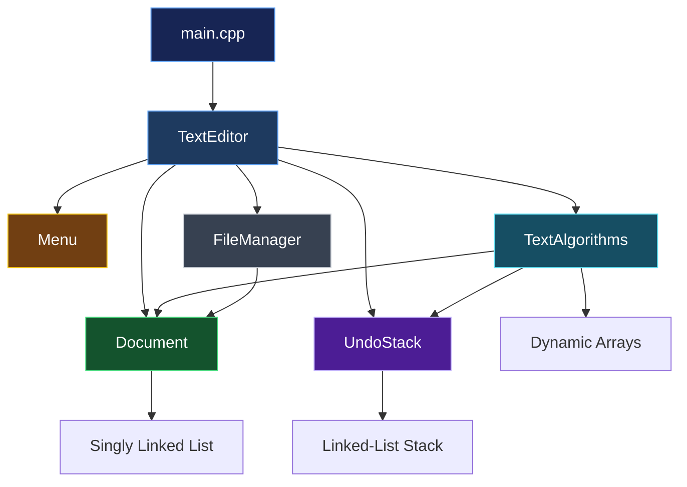

<div align="center">

# ⌘ TEXT EDITOR

### A Text Editor Built from the Ground Up.

**Understanding the mechanics of text editing through Data Structures and Algorithms.**

<br>


<br>

*A closer look at what happens behind every keystroke.*

<br>

---

</div>

## ◈ 01 — The Project

What happens when you insert a character, search for a word, replace text, or undo an edit?

A text editor may appear simple on the surface, but behind every operation lies a combination of data structures, algorithms, memory management, and file handling.

**Text Editor** is a console-based application developed in C++ that explores these underlying mechanisms through manually implemented data structures and algorithms.

Instead of relying on ready-made containers for its core functionality, the project builds its foundation using a custom singly linked list, a linked-list stack, and resizable dynamic arrays.

The objective is to understand not only how a text editor works, but also how its individual components interact to produce a functional application.

---

## ✦ 02 — Features

The editor is designed around the following capabilities:

|     | Feature                 | Description                                                      |
| :-: | :---------------------- | :--------------------------------------------------------------- |
|  📄 | **Document Management** | Create, open, save, and save documents under new filenames.      |
|  ✏️ | **Text Editing**        | Insert and delete characters and entire lines.                   |
|  🔎 | **Pattern Searching**   | Find occurrences of a pattern and display their locations.       |
|  🔄 | **Text Replacement**    | Replace the first occurrence or all non-overlapping occurrences. |
|  ↩️ | **Undo System**         | Reverse previous editing operations using a custom stack.        |
|  📊 | **Document Statistics** | Calculate line count, character count, and word count.           |
|  ⚙️ | **File Handling**       | Read from and write to text files.                               |
| 🛡️ | **Error Handling**      | Handle invalid operations, input errors, and file failures.      |

---

## ⌘ 03 — The Architecture

The project follows a modular, class-based architecture. Each component has a defined responsibility, keeping document storage, algorithms, file handling, user interaction, and application control independent.

### System Architecture



### Module Breakdown

| Module           | Responsibility                                                          |
| :--------------- | :---------------------------------------------------------------------- |
| `Document`       | Owns and manages the document's linked-list representation.             |
| `UndoStack`      | Maintains editing history and manages undo records.                     |
| `TextAlgorithms` | Implements manual searching and text replacement algorithms.            |
| `FileManager`    | Handles document reading and writing.                                   |
| `Menu`           | Collects console input and displays information.                        |
| `TextEditor`     | Coordinates application operations and communicates with other modules. |
| `main.cpp`       | Initializes and launches the application.                               |

---

## 🧠 04 — Data Structures: Under the Hood

The core of this project is built around three manually implemented data structures.

### 01 / Singly Linked List

**Purpose: Document Storage**

The document is represented as a sequence of dynamically allocated nodes. Each node stores one line of text and a pointer to the next node.

```text
 HEAD
  |
  v
+----------------+     +----------------+     +----------------+
|    Line 01     |     |    Line 02     |     |    Line 03     |
|  "Hello World" | --> |  "Text Editor" | --> |  "C++ Project" | --> NULL
+----------------+     +----------------+     +----------------+
```

**Why a linked list?**

* Dynamic memory allocation.
* No fixed document size.
* Efficient insertion and deletion of nodes once their positions are reached.
* Direct application of pointer manipulation and memory management concepts.

### 02 / Linked-List Stack

**Purpose: Undo History**

Each successful editing operation generates an undo record. These records are stored in a custom stack following the Last In, First Out (LIFO) principle.

```text
             TOP
              |
              v
        +-------------+
        |   Undo #3   |  ← Most recent operation
        +-------------+
              |
              v
        +-------------+
        |   Undo #2   |
        +-------------+
              |
              v
        +-------------+
        |   Undo #1   |  ← Oldest operation
        +-------------+
              |
             NULL
```

**Why a stack?**

* Naturally follows the order required by Undo.
* Constant-time push and pop operations.
* Demonstrates a stack implemented without `std::stack`.

### 03 / Dynamic Arrays

**Purpose: Search Results & Replacement History**

Two custom resizable arrays are used for different purposes:

| Array             | Stores                                         | Purpose                                       |
| :---------------- | :--------------------------------------------- | :-------------------------------------------- |
| `MatchArray`      | Line numbers and character positions           | Stores search results.                        |
| `TextChangeArray` | Original text, replacement text, and positions | Stores changes needed to reverse Replace All. |

The arrays expand as additional elements are inserted, avoiding the limitations of a fixed-size array.

---

## 🔍 05 — Algorithms

The editor implements its own text-processing algorithms.

| Algorithm              | Description                                              |
| :--------------------- | :------------------------------------------------------- |
| Naive Pattern Matching | Searches for a pattern by comparing characters directly. |
| Find All               | Locates every occurrence of a pattern in the document.   |
| Replace First          | Replaces the first matching occurrence.                  |
| Replace All            | Replaces all non-overlapping occurrences.                |
| Undo                   | Reverses an operation using its stored undo record.      |

### Search Behaviour

The search algorithm is designed to:

* Perform case-sensitive matching.
* Search each line independently.
* Report character positions using zero-based indexing.
* Detect overlapping matches.
* Reject empty search patterns.

### Replace All Behaviour

Replace All uses non-overlapping matches and stores the original changes required for reversal.

All replacements from one Replace All command are grouped into a single undo operation.

---

## 📁 06 — Project Structure

```text
Text-Editor-DSA/
│
├── include/
│   ├── TextEditor.h
│   ├── Menu.h
│   ├── Document.h
│   ├── UndoStack.h
│   ├── TextAlgorithms.h
│   └── FileManager.h
│
├── src/
│   ├── main.cpp
│   ├── TextEditor.cpp
│   ├── Menu.cpp
│   ├── Document.cpp
│   ├── UndoStack.cpp
│   ├── TextAlgorithms.cpp
│   └── FileManager.cpp
│
├── CMakeLists.txt
├── README.md
└── LICENSE
```

The project separates declarations from implementations:

* `include/` contains class declarations and public interfaces.
* `src/` contains the corresponding implementations and application entry point.

CMake manages the compilation and linking of all source files.

---

## 🛠️ 07 — Development Environment Setup

The project uses **C++17 and CMake**.

The recommended Windows development environment is:

* Visual Studio Code
* MSYS2 UCRT64
* GCC
* CMake
* Ninja

Other compatible C++17 development environments can also be used.

### Step 1 — Install VS Code and MSYS2

Download and install:

* Visual Studio Code
* MSYS2

### Step 2 — Install the Required Tools

Open the **MSYS2 UCRT64** terminal.

Update the package database and installed packages:

```bash
pacman -Syu
```

If the terminal closes during the update, reopen UCRT64 and run the update command again if requested.

Install the compiler and build tools:

```bash
pacman -S --needed mingw-w64-ucrt-x86_64-gcc mingw-w64-ucrt-x86_64-cmake mingw-w64-ucrt-x86_64-ninja
```

### Step 3 — Install VS Code Extensions

Open VS Code and install:

* **C/C++**
* **CMake Tools**

### Step 4 — Configure the VS Code Terminal

In VS Code:

1. Press `Ctrl + Shift + P`.
2. Select `Terminal: Select Default Profile`.
3. Choose `bash (MSYS2)` if available.

For the UCRT64 environment, ensure the terminal uses:

```text
MSYSTEM=UCRT64
```

### Step 5 — Verify Installation

Open the VS Code integrated terminal and execute:

```bash
g++ --version
cmake --version
ninja --version
```

If all three commands display version information, the development environment is ready.

---

## 🚀 08 — Build & Run

Once the development environment is configured, follow these steps.

### 01 / Clone the Repository

```bash
git clone <repository-url>
cd Text-Editor-DSA
```

### 02 / Configure CMake

```bash
cmake -S . -B build -G Ninja
```

### 03 / Build the Project

```bash
cmake --build build
```

### 04 / Run the Application

**Windows — MSYS2 UCRT64:**

```bash
./build/TextEditor.exe
```

The executable location may differ depending on the selected build generator and configuration.

> **Note:** Every team member should configure and build the project locally. The generated `build/` directory should not be committed to the repository.

---

## ⏱️ 09 — Complexity Analysis

The project also explores the computational cost of its fundamental operations.

| Operation                        | Expected Time Complexity |
| :------------------------------- | :----------------------: |
| Access a line in the linked list |           O(L)           |
| Insert a line                    |           O(L)           |
| Delete a line                    |           O(L)           |
| Insert text within a line        |           O(N)           |
| Delete text within a line        |           O(N)           |
| Push onto undo stack             |           O(1)           |
| Pop from undo stack              |           O(1)           |
| Access dynamic array element     |           O(1)           |
| Append to dynamic array          |      Amortized O(1)      |
| Naive pattern searching          |         O(N × M)         |

**Notation:**

* `L` — Number of lines in the document.
* `N` — Number of characters in the searched text or line, as applicable.
* `M` — Length of the search pattern.

Actual operation costs may also include string copying, memory allocation, and replacement overhead.

The final complexity analysis will be verified against the completed implementations.

---

## 🧪 10 — Testing & Validation

Testing will cover individual modules as well as the integration of the complete application.

Planned test cases include:

| Test Area           | What We Validate                                           |
| :------------------ | :--------------------------------------------------------- |
| Document Management | Empty documents, line insertion, deletion, and updating.   |
| Text Editing        | Character insertion, deletion, and boundary positions.     |
| Searching           | Multiple matches, overlapping matches, and no-match cases. |
| Replacement         | First occurrence and Replace All behaviour.                |
| Undo                | Reversal of different editing operations.                  |
| File Handling       | Valid files, missing files, reading, and writing failures. |
| Input Validation    | Invalid line numbers, positions, and malformed input.      |
| Integration         | Correct interaction between all modules.                   |

Test results and screenshots will be added as implementation progresses.

---

## 👥 11 — Team Contributions

Developed collaboratively as part of the CS-218 Data Structures and Algorithms course.

| Member | Responsibilities                                                               |
| :----: | :----------------------------------------------------------------------------- |
| **01** | Document management, linked-list implementation, text editing, and statistics. |
| **02** | Undo stack, undo records, dynamic change array, and console interface.         |
| **03** | Search algorithms, replacement algorithms, and dynamic search-result array.    |
| **04** | File management, application controller, and project integration.              |

---

## ◈ 12 — Project Information

|                      |                                                   |
| :------------------- | :------------------------------------------------ |
| **Project**          | Design and Implementation of a Text Editor in C++ |
| **Course**           | CS-218 — Data Structures and Algorithms           |
| **Institution**      | NED University of Engineering and Technology      |
| **Language**         | C++17                                             |
| **Build System**     | CMake                                             |
| **Application Type** | Console-Based                                     |

---

<div align="center">

<br>

# ✦

### Built from the fundamentals.

**Designed to understand what happens underneath.**

<br>

`C++`   ·   `Data Structures`   ·   `Algorithms`

<br>

**NED University of Engineering and Technology**

</div>
